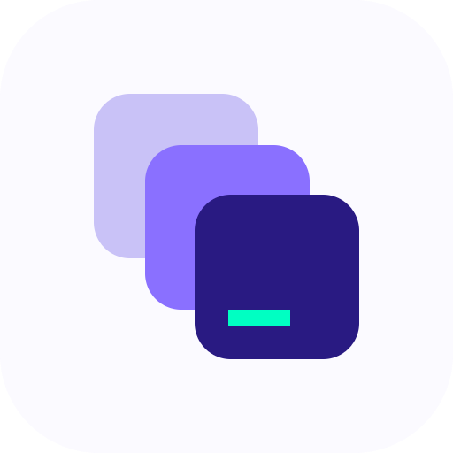

<p align="center">
  
</p>

# Artifactry MCP connector

Artifactry is a shared library for the work teams create with AI: code, React components, HTML pages, Markdown documents, SVG diagrams and data. The Artifactry connector lets AI apps search, read and save that work over the [Model Context Protocol](https://modelcontextprotocol.io). You can bring earlier work into a conversation and save new work back without copying and pasting.

This repository holds the connector's public listing metadata and a setup summary. The connector is a hosted service, so there's nothing here to install or run.

```
https://mcp.artifactry.ai/mcp
```

Transport: Streamable HTTP. Authentication: OAuth 2.1 with PKCE and dynamic client registration.

## Connect an AI app

You need an Artifactry account. Accounts are created by invitation, or you can request access at [artifactry.ai](https://artifactry.ai).

| App | Status | Setup |
| --- | --- | --- |
| Claude (web) | Available | **Settings → Connectors → Add custom connector**, paste the URL, then sign in. Custom connectors need a paid Claude plan. |
| ChatGPT | Available | Turn on **Developer mode**, add a connector with the URL, choose **OAuth**, then sign in. Needs a paid plan with developer mode. |
| Google Antigravity | Available | Add a custom MCP server under **Customizations**, using the configuration below. |
| Microsoft Copilot Studio | Admin setup | **Tools → Add a tool → Model Context Protocol**, paste the URL, choose **OAuth 2.0 → Dynamic discovery**. |
| Notion Custom Agents | Admin setup | A workspace admin enables custom MCP servers. You then connect with a personal access token. |
| Slack (Slackbot) | Admin setup | A workspace admin adds the URL. Each person signs in with their own account. |
| VS Code, Cursor and other desktop editors | Rolling out | Sign-in from desktop editors isn't available yet. |

Antigravity (`~/.gemini/config/mcp_config.json`). Antigravity expects `serverUrl`, not `url`:

```json
{
  "mcpServers": {
    "artifactry": {
      "serverUrl": "https://mcp.artifactry.ai/mcp"
    }
  }
}
```

Step-by-step instructions for every app are at **[artifactry.ai/docs/connectors](https://artifactry.ai/docs/connectors)**.

## Tools

| Tool | What it does | Changes data |
| --- | --- | --- |
| `search_artifacts` | Find artifacts by title or description, filtered by type or tag. | No |
| `list_artifacts` | List what's in a workspace, newest first. | No |
| `get_artifact` | Read one artifact by its id. | No |
| `search` | Search and return citable results, each with a link back to the artifact. | No |
| `fetch` | Read one search result's full text, with a link to cite. | No |
| `create_artifact` | Save new work as an artifact, in a workspace you can write to. | Yes |
| `update_artifact` | Change an artifact's title, content or tags. Earlier versions stay in version history. | Yes |
| `delete_artifact` | Permanently remove an artifact. Marked destructive, and its description tells the AI app to confirm with you first. | Yes |

## How access works

- **You sign in as yourself.** The AI app opens Artifactry's sign-in, you sign in, and you approve the connection. There's no API key to paste.
- **Same permissions as the web app.** The app acts as you and reaches only the workspaces and artifacts you can already see, under the same role-based permissions.
- **The connector handles every request**, so your workspace is never exposed directly to the model.
- **Saved work stays private to its workspace** until someone shares it in Artifactry.
- **To disconnect**, remove Artifactry from the AI app's connector settings. Personal access tokens can be revoked at any time under **Settings → Access tokens** in Artifactry.

## What's in this repository

| Path | Purpose |
| --- | --- |
| [`server.json`](server.json) | The connector's record for the [Official MCP Registry](https://registry.modelcontextprotocol.io), as `ai.artifactry/artifactry`. |
| [`assets/`](assets) | Icons: light and dark SVG, plus 512 px and 400 px PNG. |

## Help

- Documentation: [artifactry.ai/docs/connectors](https://artifactry.ai/docs/connectors)
- Support: [support@progredisystems.com](mailto:support@progredisystems.com)
- Privacy: [progredisys.com/privacy](https://progredisys.com/privacy)
- Security issues: see [SECURITY.md](SECURITY.md). Please don't report them in public.

## License

The files in this repository are available under the [MIT License](LICENSE). The Artifactry name and logo are trademarks of Progredi Systems LLC and aren't covered by that license.

Artifactry is built by [Progredi Systems](https://progredisys.com).
